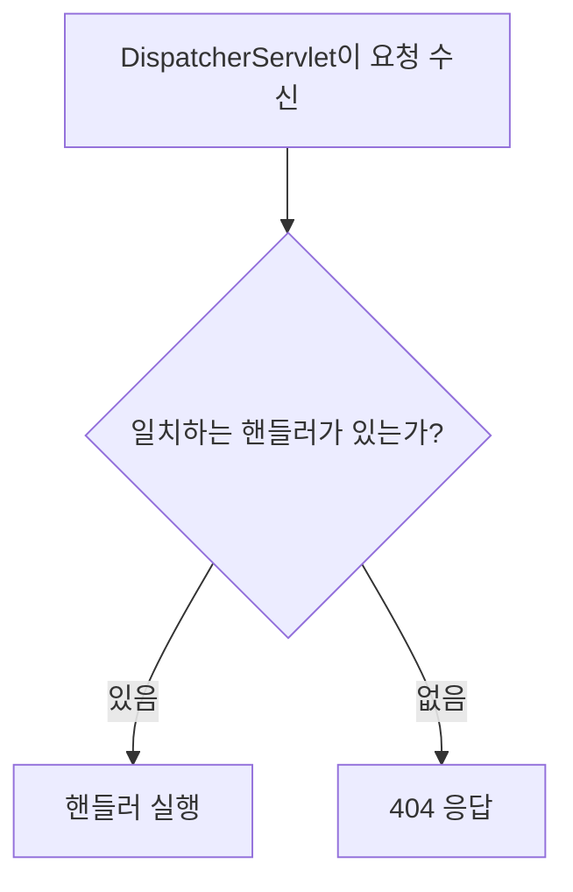

# 읽기 화면

| 주소 | 내용 |
| --- | --- |
| `/` | 짧은 소개, stack 목록, 최근 글 순서 |
| `/stack/` | 전체 stack 목록 |
| `/stack/<stack>/` | 해당 stack의 글 목록 |
| `/stack/<stack>/<slug>/` | 경로, 제목·날짜, 목차, 본문, stack으로 돌아가기 |
| 404 | 기본 오류 화면과 돌아갈 링크 |

글 목록은 작성일 내림차순으로 정렬해줘. 목록은 제목, 날짜, 얇은 구분선을 중심으로 책의 목차처럼 구성해줘. 문서 상세는 밝은 종이색과 충분한 행간을 갖춘 반응형 단일 열로 만들어줘. 웹폰트를 불러오는 동안에도 글이 보이도록 대체 글꼴을 지정해줘.

목차는 기본으로 접고 키보드로도 열 수 있게 해줘. 소제목이 없는 글은 제목과 날짜 다음에 바로 본문을 보여줘. 절 번호는 글에 맞게 선택할 수 있게 하고, 인쇄할 때도 본문이 읽히도록 기본 스타일을 넣어줘.

## 한글과 영문이 섞인 본문

본문, 목록, 제목의 한글과 영문에는 같은 글꼴인 **Sarasa Gothic K**를 써. 인라인 코드, 코드 블록, 경로에는 고정폭 글꼴인 **Sarasa Mono K**를 써. 한글 사이에 영문 용어가 들어가도 한 문장으로 편하게 읽혀야 해.

> Spring MVC에서 `DispatcherServlet`은 HTTP 요청을 처리할 핸들러를 찾는다.

이 문장에서 Spring MVC와 HTTP는 주변 한글과 같은 Sarasa Gothic K로, `DispatcherServlet`은 Sarasa Mono K로 조판해. 데스크톱과 모바일에서 HTTP 같은 대문자 약어가 주변 한글보다 유난히 크거나 진해 보이는지, 클래스 이름 뒤의 조사 ‘은’이 자연스럽게 이어지는지 살펴봐. 좁은 화면에서는 긴 식별자가 들어간 줄의 여백과 줄바꿈도 확인해.

## Markdown 표현과 접근성

- 제목, 목록, 인용, 링크, 구문 강조 코드, 표, 이미지와 대체 텍스트, 그림·표 캡션, 각주, 인라인·블록 수식, Mermaid를 지원해줘. 수식은 빌드 시 렌더링하고 필요한 CSS와 폰트를 포함해. Mermaid는 빌드 시 SVG로 변환해줘. 렌더링에 실패하면 원본 파일과 원인을 알려줘.
- JavaScript를 꺼도 본문과 기본 탐색이 작동하고, CSS가 없어도 의미 있는 순서로 읽혀야 해. 긴 코드, 넓은 표, 큰 수식과 다이어그램은 각 영역 안에서 스크롤되게 해줘. 링크와 키보드 포커스가 선명해야 해.

## Mermaid 다이어그램

모든 글에 같은 기본 테마를 적용해. 종이색 배경에 옅은 면과 얇은 테두리로 노드를 그리고, 레이블과 화살표는 본문처럼 짙게 표시해. 강조할 단계 한 곳에는 링크와 같은 짙은 녹색을 쓸 수 있어. 분기는 선 옆에 ‘있음’, ‘없음’처럼 결과를 적어서 흑백으로도 경로를 따라갈 수 있게 해.

레이블은 한글 설명과 영문 클래스명 모두 Sarasa Gothic K로 맞춰. 빌드에서 이 글꼴을 불러온 뒤 노드 크기와 화살표 위치를 계산해. 긴 이름은 온전히 읽히고, 글자와 테두리 사이에는 여백이 남고, 화살촉이 옆 레이블을 가리지 않아야 해.

비공개 `Example`에는 아래 흐름도와 참여자가 여러 명인 넓은 시퀀스 다이어그램을 넣어. 그림이 전달하는 내용을 제목과 짧은 설명으로 남기고, 빌드한 SVG에서도 보조기기로 읽을 수 있게 해. [Mermaid의 접근성 제목과 설명](https://mermaid.js.org/config/accessibility.html)

구현 후에는 `npm run preview`에서 두 그림을 확인해. 320px 화면에서 작은 흐름도는 한눈에 읽혀야 하고, 넓은 시퀀스 그림은 글자 크기를 유지한 채 그림 안에서만 가로로 스크롤해 마지막 참여자까지 읽을 수 있어야 해. 인쇄 미리보기에서는 두 그림의 바깥 테두리와 마지막 화살표까지 용지 안에 들어오는지 확인해.

[홈과 문서 상세 스케치](화면-스케치.html)

---

[이전 문서 ‹ 문서 작성과 공개](문서-작성과-공개.md) · [문서 목록](README.md) · [2차 설계 › 검토와 배포](검토와-배포.md)
